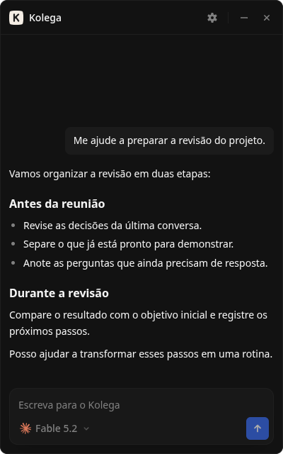
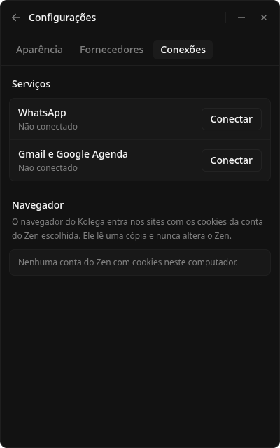
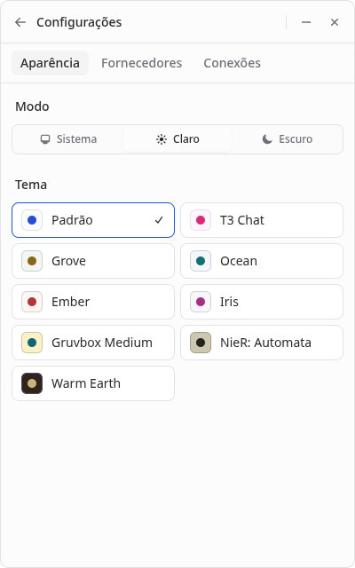

<div align="center">


# Firmino

**A personal assistant that stays on your desktop.**<br>One conversation for your calendar, messages, browser and recurring tasks.

    

[Run locally](#run-locally) · [Connected services](#connected-services) · [Under the hood](#under-the-hood)

<br>



<sub>Captured from main with sample messages in a separate local profile. The interface is in Portuguese.</sub>

</div>

The main branch still uses the previous name, **Kolega**, in its interface and installation paths. The screenshots show that version.

## Highlights

- **Your existing AI accounts.** Use Codex or Claude through the CLIs installed on your computer, with selectable accounts and models.
- **Work that comes back on time.** Schedule a task once, on selected weekdays or at recurring intervals while the app is running.
- **Messages that start a task.** Set triggers for chosen WhatsApp chats or Gmail senders, with instructions for handling incoming messages.
- **A browser you can take over.** Let the agent work in an embedded browser, then hand control back to you when needed.
- **Memory across conversations.** Notes and conversation history live in a local SQLite database.

## Connected services

Connect WhatsApp with a QR code. Connect Gmail and Google Calendar through Google sign-in, using your own OAuth client configuration.

The agent can read and send messages, search email, create drafts and manage calendar events. Browser sessions can import cookies from a selected Zen Browser identity.

<p align="center">
  
  <br>
  <sub>A separate demo profile with no connected services or imported browser cookies.</sub>
</p>

WhatsApp uses Baileys, an unofficial client. Local storage includes service credentials; requests still go to the selected AI provider and connected services.

## A space that fits your desktop

The compact window stays beside your work. Choose a light or dark appearance and a palette, including T3 Chat, Gruvbox and NieR: Automata.

<p align="center">
  
</p>

## Run locally

Requires [Bun](https://bun.sh), plus an installed and authenticated Codex or Claude CLI for agent conversations.

```bash
git clone https://github.com/pedrinhopagan/firmino.git
cd firmino
bun install
bun run dev
```

In shells that export `ELECTRON_RUN_AS_NODE=1`, start Electron with that variable removed:

```bash
env -u ELECTRON_RUN_AS_NODE bun run dev
```

<details>
<summary>Google sign-in</summary>

Create a Google OAuth desktop client and enable the Gmail and Google Calendar APIs. Set `MAIN_VITE_GOOGLE_CLIENT_ID` before building or starting development. Set `MAIN_VITE_GOOGLE_CLIENT_SECRET` when your client supplies one.

The app opens the Google consent screen when you connect. WhatsApp pairing and browser setup are separate.

</details>

<details>
<summary>Linux packaging</summary>

```bash
bun run package:linux
```

The AppImage is written to `release/`. To build and install it with a menu entry and tray autostart:

```bash
bun run install:linux
```

On the current main branch, the installed executable is `~/.local/bin/kolega`.

</details>

## Under the hood

| Part | Responsibility |
| --- | --- |
| Electron Main | Window, system tray, embedded browser and the Engine lifecycle |
| Bun Engine | Conversation state, schedules, memory and service integrations |
| React Renderer | Conversation, account selection, connections and appearance |
| oRPC over loopback | Renderer-to-Engine calls authenticated with a per-run token |
| SQLite | Local conversation history, settings, routines, triggers and memory |
| MCP | Tools exposed to the selected Codex or Claude session |

<details>
<summary>Development commands</summary>

| Command | Purpose |
| --- | --- |
| `bun run dev` | Start the desktop app in development mode |
| `bun run build` | Compile the Bun Engine and build the Electron app |
| `bun run typecheck` | Check TypeScript |
| `bun run check` | Run the configured code checks |
| `bun run package:linux` | Build the Linux AppImage |

</details>

Built by [Pedro Pagan](https://www.devpedropagan.com.br/).
